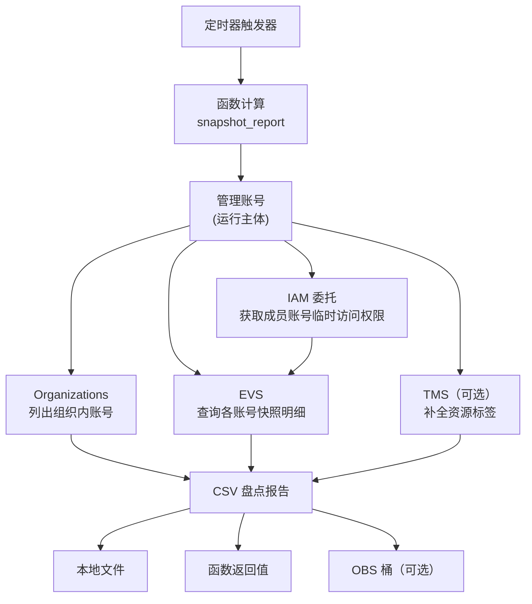

# 架构说明

## 1. 架构总览

本实践提供一套**组织级云硬盘（EVS）快照盘点方案**：由管理账号运行盘点程序，通过华为云 Organizations 枚举组织内成员账号，借助 IAM 委托获取各成员账号的临时访问权限，调用 EVS 接口收集快照明细，并可选用 TMS 标签补全归属信息，最终汇总为 CSV 报告。盘点程序既可在本地以命令行方式运行，也可部署为函数计算定时任务，实现每日自动盘点。

方案不创建虚拟私有云、子网、NAT 网关或弹性公网 IP：函数计算通过默认出口调用华为云接口，保持零公网网络组件的精简形态。



## 2. 组件与职责

| 组件 | 服务 | 职责 |
|---|---|---|
| 账号枚举 | 组织服务 Organizations | 列出组织内处于激活状态的账号 |
| 跨账号访问 | 统一身份认证 IAM（委托） | 由成员账号授予委托，管理账号获取临时访问权限 |
| 快照采集 | 云硬盘 EVS | 按账号与区域查询快照明细 |
| 归属补全 | 标签管理服务 TMS（可选） | 读取快照标签，补充负责人 / 团队 / 实例信息 |
| 调度执行 | 函数计算 FunctionGraph | 承载盘点程序，由定时器触发 |
| 定时触发 | 定时器触发器 | 按计划周期（默认每日）触发盘点函数 |
| 报告落盘 | 对象存储服务 OBS（可选） | 按需将 CSV 报告归档到对象存储 |
| 运行凭据 | 华为云访问密钥 | 由使用者在会话中提供，用于接口调用与部署 |

## 3. 部署形态

- **命令行形态**：在本地运行盘点脚本，适合首次验证逻辑、按需盘点或临时排查。报告以本地 CSV 文件输出。
- **函数调度形态**：将同一份盘点程序部署为函数计算，由定时器每日触发；报告作为函数返回值，也可选写入 OBS 桶。此形态默认不创建 OBS 与网络组件。
- **跨账号前置**：需要在每个成员账号中一次性创建委托并授予快照读取权限，管理账号方可跨账号采集；未完成该步骤时仅能盘点管理账号自身快照。

## 4. 目录与代码布局

```text
lean-governance-ebs-snapshot-inventory/
├── infra/                       # Terraform：委托、函数、定时器、可选 OBS
│   ├── main.tf                  # 资源定义与函数代码部署
│   ├── variables.tf             # 变量声明（区域、委托名、报告桶、调度表达式等）
│   └── outputs.tf               # 输出（函数名、函数 URN、委托名、定时器 ID 等）
├── src/
│   ├── adapter/                 # 盘点脚本与依赖声明
│   └── functions/               # 函数打包与部署辅助脚本
├── docs/                        # 架构说明与部署指南
├── README.md                    # 实践说明主文档
└── LICENSE                      # MIT No Attribution
```

## 5. 关键设计决策

- **零公网网络组件**：函数计算使用默认出口访问华为云接口，不创建 VPC / 子网 / NAT / EIP，降低组件数量与维护成本。
- **委托模型跨账号**：以 IAM 委托替代在成员账号常驻程序或长期密钥，权限边界清晰且便于回收。
- **脚本与函数复用**：同一份盘点脚本既作为本地命令行工具，也作为函数计算入口，避免两套逻辑分叉。
- **报告落盘可选**：默认输出到本地文件或函数返回值，仅当配置报告桶时才启用 OBS 归档。

## 6. 设计约束与已知限制

- 跨账号盘点依赖成员账号预先创建委托，组织规模较大时需逐账号完成一次性配置。
- 函数计算的单次执行时长与内存由变量控制，组织内账号与快照数量较多时应相应调高。
- 本实践聚焦盘点与报告生成，不含快照清理、生命周期策略等治理动作。
- 资源销毁与残留检查见部署指南的「清理资源」章节。
